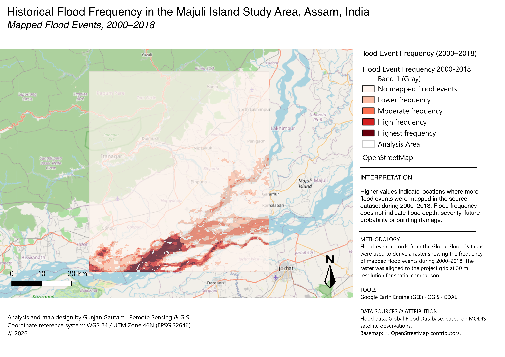
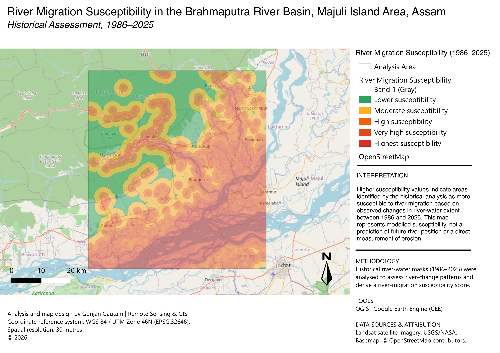
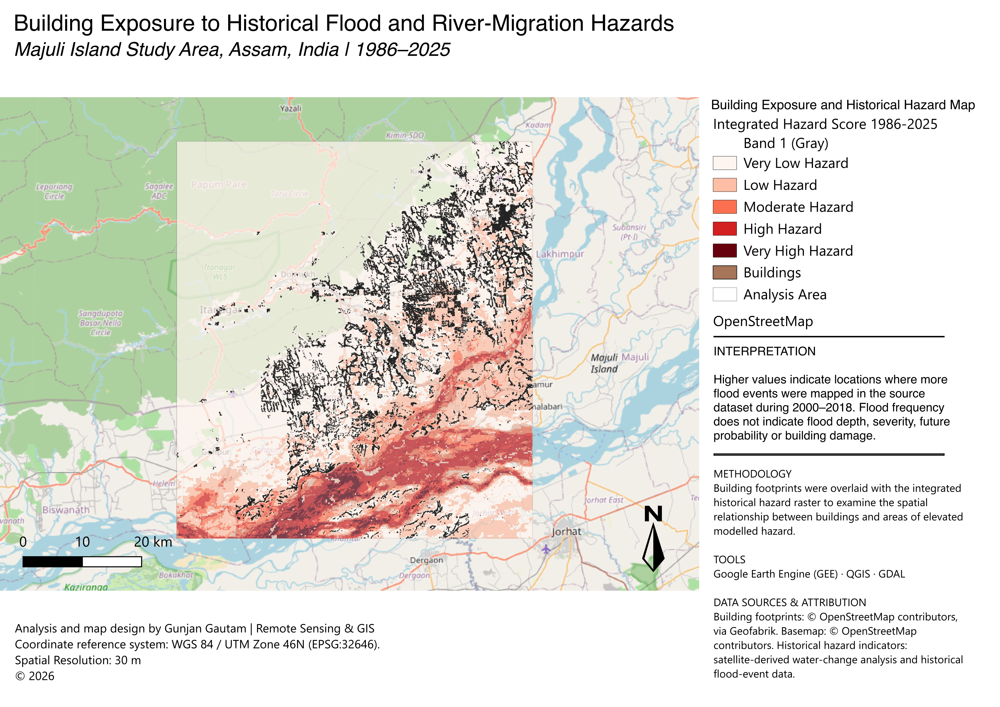
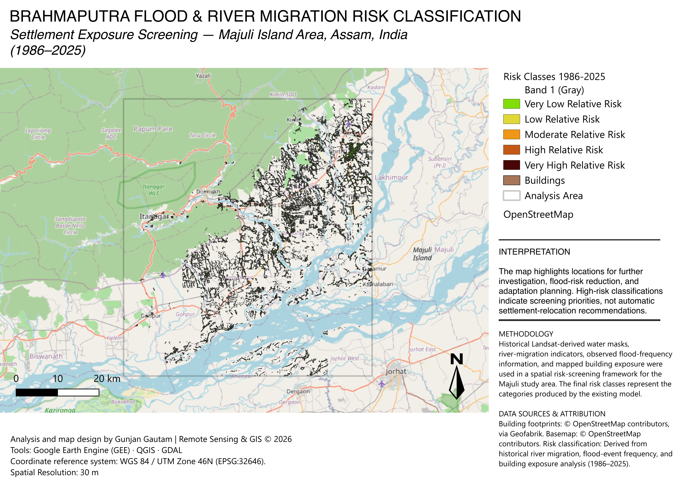

[README.md](https://github.com/user-attachments/files/33533940/README.md)
# Brahmaputra Flood Risk & River Migration Screening — Majuli, Assam, India

A GIS and remote-sensing portfolio project combining historical river-water change, historical flood-event frequency, and mapped building exposure to screen for locations that may warrant closer flood-risk investigation.

> **Important interpretation:** This is a historical, relative-risk screening exercise. It is not a calibrated flood probability, a flood-depth or velocity model, a forecast of the river's future path, or an instruction to relocate any community.

## Study area

The analysis focuses on the project area around Majuli and the Brahmaputra floodplain in Assam, India—not the entirety of Assam. The working projected coordinate reference system is **WGS 84 / UTM zone 46N (EPSG:32646)**. The aligned analysis grid used for key outputs is approximately 30 m with 1,999 columns × 2,230 rows. A 30 m output grid does not mean every source dataset has 30 m spatial detail.

## Maps

1. **Flood Event Frequency (2000–2018)** — `maps/01_flood_frequency_2000_2018.png`
2. **Historical River Migration (1986–2025)** — `maps/02_historical_river_migration_1986_2025.png`
3. **Integrated Historical Hazard** — `maps/03_integrated_historical_hazard.png`
4. **Final Relative Risk Classification (1986–2025)** — `maps/04_final_risk_classification_1986_2025.png`

### Map previews

#### 1. Flood frequency


#### 2. Historical river migration


#### 3. Integrated historical hazard


#### 4. Final risk classification


## Questions explored

- Where has mapped river-water extent changed repeatedly over the selected historical observations?
- Where do historical flood-event observations recur?
- How do the historical hazard indicators overlap with mapped building footprints?
- Which areas are flagged by the project's relative risk classification for follow-up investigation?

## Workflow overview

Landsat Collection 2 Level-2 scenes
              │
              ▼
      NDWI water masks
      (selected years)
              │
              ▼
   Water-change intervals
              │
              ▼
 River occurrence / gain-loss
 / migration envelope / activity
              │
              ├────────────────────────────┐
              ▼                            ▼
 Historical river indicator       Global Flood Database
 (1986–2025 observations)          (2000–2018 events)
                                           │
                                           ▼
                                 Per-pixel event frequency
              │                            │
              └──────────────┬─────────────┘
                             ▼
                  Integrated hazard indicators
                             │
                 Building footprint exposure
                             │
                             ▼
                 Relative risk score and classes
                             │
                             ▼
                   Four exported map products
```

The workflow was carried out in Google Earth Engine (GEE) and QGIS. The repository includes explanatory/reusable GEE scripts and documentation. The QGIS processing steps are documented at a reproducible, high level; exact score weights and class-break rules should only be added after checking the saved QGIS model/calculator expressions.

## Tools

- **Google Earth Engine (JavaScript):** Landsat water-index masks and historical flood-event frequency.
- **QGIS:** Raster alignment, change analysis, raster styling, integrated hazard/risk mapping, building-footprint overlay, and cartographic exports.
- **Coordinate reference system:** EPSG:32646 for the main analysis grid.

## Repository structure

```text
Assam-Brahmaputra-Flood-Risk/
├── README.md
├── LICENSE
├── CITATION.cff
├── .gitignore
├── maps/                       # Final exported map images
├── qgis/                       # QGIS project file, if portable and verified
├── scripts/
│   └── gee/
│       ├── 01_landsat5_water_mask_1986.js
│       ├── 02_landsat9_water_mask_2025.js
│       └── 03_global_flood_frequency_2000_2018.js
├── documentation/
│   ├── methodology.md
│   ├── data_sources.md
│   ├── limitations.md
│   └── reproducibility.md
└── data/
    └── README.md
```

## Data and reproducibility

The repository deliberately does not bundle large rasters, all source imagery, or third-party building datasets. See [`data/README.md`](data/README.md) and [`documentation/data_sources.md`](documentation/data_sources.md) before adding data. Keep source datasets' licences and attribution requirements intact.

The GEE scripts avoid local computer paths. For the water-mask scripts, define/import the correct study-area geometry in the GEE Code Editor before running, then inspect the selected scene and map before exporting. The flood-frequency script uses a broad Assam bounding box for event filtering; the final export is clipped to the imported/drawn project study area if provided.

## Risk-class interpretation

The final raster contains relative classes 1–5, interpreted in the project symbology as:

| Class | Label |
|---:|---|
| 1 | Very Low Risk |
| 2 | Low Risk |
| 3 | Moderate Risk |
| 4 | High Risk |
| 5 | Very High Risk |

These labels describe the model's relative ranking, not absolute probability or guaranteed damage. Use the map to prioritize field verification and additional data collection—not as a stand-alone basis for relocation or land-use restrictions.

## Limitations at a glance

- The historical river indicators represent selected water observations, not a physically modelled prediction of future channel migration.
- Flood-event frequency is derived from a coarser-resolution MODIS-based product (commonly described at about 250 m); resampling/alignment to a 30 m grid does not create finer source information.
- River-migration and flood-frequency periods differ: 1986–2025 and 2000–2018, respectively.
- Building footprints indicate mapped built structures, not occupancy, population, structural vulnerability, damage or social vulnerability.
- Flood depth, flow velocity, evacuation access, critical infrastructure, household vulnerability, community preferences and relocation feasibility are not fully represented.
- Model weights, normalization, thresholds and data quality affect the results.

See [`documentation/limitations.md`](documentation/limitations.md) for the fuller discussion.

## Author

**Gunjan Gautam** — Environmental Science, GIS & Remote Sensing.

## How to cite

See [`CITATION.cff`](CITATION.cff). When publishing, update the author, repository URL, and release details as needed.
putra-Flood-Risk
